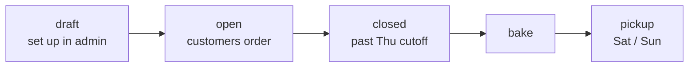
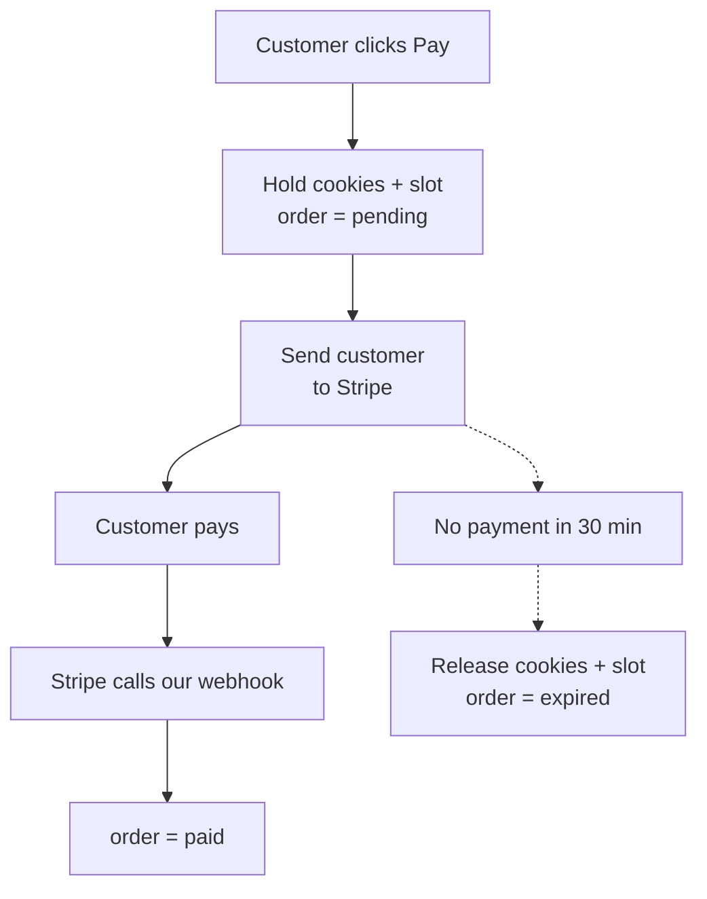
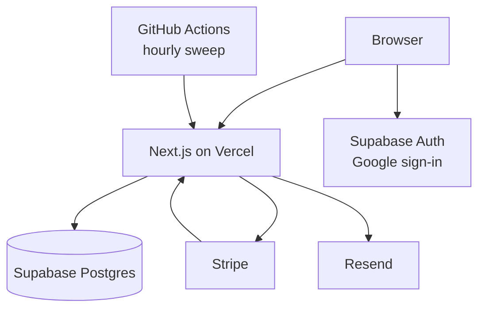

# Dawg Treats — System Design Doc

2026-09-17 · @Someone

## Requirements

- Orders close Thursday 11:59pm PT.
- Pickup Sat or Sun only, 30-minute slots, max 5 orders per slot.
- Quantity limits are per flavor, per week.
- No refunds or cancellations, stated in the fine print.

Customers browse active flavors, cart, pick a pickup slot, pay by card or Apple Pay, look up an order by code; optional Google sign-in for history. The admin runs weeks, quantities, slots and flavors from a command-line tool (`npm run admin`), not from admin pages.

Rules:

Non-goals for v1: delivery, cash or Venmo, discounts, in-product refunds, drop announcement emails.

## The week: core concept

A **week** is one round of baking and selling: it owns that round's quantities, slots and orders.

A week is orderable when `status = open` and now is before `orders_close_at`; checkout re-checks both. With no open week the site shows active flavors and no order buttons. A week left in `draft` is skipped.

**Creating a week.** The admin doesn't pick dates. The server creates the upcoming week: the next Saturday whose Thursday 11:59pm PT cutoff is still ahead (from Friday on, that is the following weekend), with `orders_close_at` set from it. There is one week per weekend.

**Opening and closing.** A week opens only with at least one flavor quantity and one pickup slot, and only one week is open at a time. Ordering stops at the cutoff on its own; the admin closes the week afterwards so the next one can open.

## Data model

Postgres. Money in integer cents, timestamps in UTC, displayed in PT.

| Table | Holds | Key fields |
| --- | --- | --- |
| `users` | People with Google accounts | `id`, `supabase_uid`, `email`, `name`, `phone`, `role` (customer \| admin) |
| `flavors` | The menu | `id`, `name`, `description`, `price_cents`, `image_url`, `active` |
| `weeks` | One round of baking | `id`, `pickup_weekend_start`, `orders_close_at`, `status` (draft \| open \| closed) |
| `batch_items` | Per-flavor stock for a week | `week_id`, `flavor_id`, `quantity_total`, `quantity_remaining` |
| `pickup_slots` | 30-minute windows | `week_id`, `starts_at`, `ends_at`, `capacity`, `booked_count` |
| `orders` | One checkout | `id`, `order_code`, `week_id`, `pickup_slot_id`, `user_id?`, `name`, `email`, `phone`, `status`, `total_cents`, `stripe_session_id`, `reserved_until`, `paid_at` |
| `order_items` | Cookies in an order | `order_id`, `flavor_id`, `quantity`, `unit_price_cents` |
| `payments` | Stripe charge record | `order_id`, `stripe_payment_intent_id`, `amount_cents`, `status` |
| `stripe_events` | Webhook idempotency | `stripe_event_id`, `type`, `processed_at` |
| `feedback` | What anyone said about the cookies | `id`, `rating?`, `message`, `name?`, `created_at` |

**Order status**: `pending` → `paid` → `ready` → `picked_up`, plus `expired`.

Constraints:

- Check: `quantity_remaining >= 0`, `booked_count <= capacity`, `rating is null or rating between 1 and 5`.
- Unique: `order_code`, `stripe_session_id`, `stripe_payment_intent_id`, `stripe_event_id`, `(week_id, flavor_id)`, `pickup_weekend_start`.
- `unit_price_cents` freezes price at purchase; flavors are deactivated, never deleted.
- `order_code` is random and non-sequential: it is the only thing guarding a guest's order page.

## Checkout flow

The cart is browser-only. Nothing is reserved until checkout starts; an order is paid only when Stripe says so.

**Reservation.** Checkout subtracts the cookies and books the slot in one all-or-nothing transaction, using conditional updates (`... WHERE quantity_remaining >= :qty`, `... WHERE booked_count < capacity`) so a row only moves if there is room. Any statement affecting zero rows rolls everything back; otherwise the `pending` order is inserted with prices read from the database, not the request.

**Hold length is 30 minutes**, matching Stripe's minimum Checkout session expiry. This is deliberate: stock is released only after Stripe confirms the session is dead, so a payment can never land for cookies already given away. A shorter hold would mean expiring the session by API and handling a race where a payment completes in the gap, which needs an automatic-refund fallback.

**Webhooks are the source of truth.** Stripe calls us directly: `session.completed` marks the order paid, `session.expired` releases the stock and slot. Both verify the signature, skip event ids already seen, and apply only to `pending` orders, so the browser redirect never marks anything paid.

**Backup sweep.** An hourly job asks Stripe what happened to any order stuck `pending` over 35 minutes. Without it a single missed webhook holds stock forever.

## Architecture and services

One Next.js app is the only thing that touches the database. The browser never queries Postgres directly.

| Service | Role | Notes |
| --- | --- | --- |
| Vercel | Hosts the Next.js app | Free tier; cron is daily-only there, hence GitHub Actions. Functions run in `pdx1`, next to the database |
| Supabase | Postgres, Google auth, flavor images | Free projects pause after inactivity; watch before a break. `us-west-2`. The app uses the transaction pooler (`DATABASE_URL`, `prepare: false`); migrations use the session pooler (`DIRECT_URL`), since the direct host is IPv6-only |
| Drizzle | Database access from the server | Typed schema and migrations, with raw SQL for the reservation |
| Stripe Checkout | Card and Apple Pay, hosted page | Apple Pay is a dashboard toggle; no card data touches the app |
| Resend | Order confirmation email | Needs an owned domain, so it lands once the domain is bought |
| GitHub Actions | Hourly backup sweep | Calls a secret-protected route |
| Sentry | Error tracking | Chosen over Datadog, which targets infrastructure at a much larger scale |

**Secrets.** Database URL, Stripe secret and webhook signing secrets, and the cron secret stay in Vercel env vars; `CRON_SECRET` is also a GitHub Actions secret, since the hourly sweep calls the site with it. The browser gets only the Supabase anon key, for sign-in. RLS on everywhere as a backstop.

**Domain.** Development runs on `dawgtreats.vercel.app`; a domain is bought at the email step, since Resend needs a verified one. The site URL is a single env var.

## Pages and endpoints

**Customer pages**

| Path | Purpose |
| --- | --- |
| `/` | Menu of active flavors; ordering enabled only when a week is open |
| `/cart` | Quantities and total |
| `/checkout` | Pickup slot, contact details, fine print, pay button |
| `/order/[code]` | Polls until paid, then shows status; also where `/order/lookup` sends you |
| `/order/lookup` | Enter an order code |
| `/account` | Order history and saved contact info |
| `/feedback` | Star rating, message, optional name |

**Admin is a CLI, not pages.** `scripts/admin.ts` (`npm run admin -- <command>`) creates and opens weeks, sets quantities, adds and removes slots, and manages flavors. It calls the same `lib/` modules the site uses, so quantities still can't drop below what is sold, slots with orders still can't be removed, and only one week is open at a time. It runs on the owner's machine with the database URL from `.env.local`, so there is no admin role to protect and no admin surface on the public site.

The one admin screen is the pickup-day view at `/pickup`: a slot-by-slot list of a week's paid orders with bagged and picked-up buttons, since that job happens at the door, not at a terminal. It is gated on `users.role = 'admin'` (granted with `npm run admin -- admin:add <email>`), 404s for anyone else, and changes orders through server actions that re-check the admin every call. Transitions are status-guarded the same way payment is: `paid -> ready -> picked_up`, with a direct `paid -> picked_up` for someone who arrives before their bag is packed.

**Endpoints**

| Method and path | Purpose |
| --- | --- |
| `POST /api/checkout` | Reserve, create the order, return the Stripe URL |
| `GET /api/orders/[code]` | Order status; rate-limited, no contact details returned |
| `PATCH /api/me` | Update the signed-in account's own saved contact info |
| `POST /api/webhooks/stripe` | Handles `session.completed` and `session.expired` |
| `GET /api/cron/sweep` | Hourly backup sweep; requires the cron secret |
| `GET /auth/callback` | Google sign-in redirect; exchanges a code via Supabase |
| `POST /auth/signout` | Signs the current account out |

There is no menu or slots endpoint: `/` and `/checkout` read flavors, stock and slots directly
in server components via `lib/inventory`. There is no admin endpoint either: `/pickup`
mutates orders through server actions in `app/pickup/actions.ts`, each re-checking
`currentAdmin()` itself, not through an API route. See `docs/AUDIT.md` for who is allowed to
call what.

Week setup has no endpoints: it runs through the CLI. Quantity edits cannot drop below what is already sold or held by a pending checkout, and a slot with orders cannot be deleted; `lib/` enforces both wherever the call comes from.

## Failure cases

| Failure | Handling |
| --- | --- |
| Two checkouts race for the last cookies | Conditional `UPDATE` means one wins; the loser gets a named sold-out error and a refreshed cart |
| Customer abandons checkout | Stock held 30 minutes, released on the `session.expired` webhook |
| Webhook never arrives | Hourly sweep reconciles against Stripe; Stripe also retries |
| Webhook arrives twice | `stripe_events` dedupe, plus status-guarded updates |
| Confirmation email fails | Logged and retried out of band; never fails the webhook, since the order is already paid |
| Stripe unavailable at checkout | Reservation rolled back immediately so stock is not held for an order that never started |
| Supabase paused or down | Site shows a clear error instead of a broken page; watch for pause warnings before breaks |
| Server crashes mid-checkout | Transaction rolls back; an orphan `pending` order is swept within the hour |
| Payment lands after expiry | Cannot happen with a 30-minute hold, since release waits for Stripe's own expiry |
| Fewer cookies baked than sold | Admin can lower quantity but never below sold; affected customers contacted and refunded by hand |
| Customer pays and never collects | No refund per policy; order left marked and cookies resold or eaten |
| Order-code guessing | Long random codes, rate-limited lookups, no contact details on the status page |
| Checkout spam holding stock | Rate limit by IP, cap cookies per order, watch for a pile of `pending` orders |
| Locked out of admin | Self-revocation blocked; roles can be fixed directly in Supabase |

## Instrumentation

Most metrics come from `orders.status`. v1 adds structured logs (`checkout_started`, `order_paid`, `order_expired`) and Sentry.

- Checkouts started vs paid vs expired, and time from start to payment: says whether the 30-minute hold costs sales.
- Failed checkouts from sold-out flavors or full slots.
- Cookies sold per flavor per week, and which slots fill first.
- Stuck orders found by the sweep: a rising count means webhooks are being missed.

## Alternatives considered

| Decision | Alternative | Why not |
| --- | --- | --- |
| Postgres | Firestore | No joins, transactions need more hand-written logic, and reporting is awkward; the overselling rule is the whole problem, and SQL solves it in one statement |
| Stripe Checkout, 30-minute hold | Stripe Elements, 10-minute hold | Elements lets the server check the timer before charging, which is how ticketing sites hold seats for 10 minutes, but it means building the payment page, handling 3D Secure, and verifying the domain for Apple Pay |
| Supabase Auth, Google only | Firebase phone auth | SMS needs a billing-enabled plan at roughly $0.01 per message and opens a bot-driven cost risk; Google sign-in is free and already verifies the email |
| Link guest orders by email | Link by phone | Phone numbers at checkout are unverified, so anyone could claim another person's history |
| GitHub Actions for the sweep | Vercel Cron | Vercel's free tier only allows daily schedules |
| Sentry | Datadog | Datadog targets infrastructure monitoring at a scale this project will not reach |

## If this grew 100x

- Drops that sell out in seconds: queue checkout, cache the menu, read availability from Redis.
- Contention on one hot `batch_items` row: split stock across several rows per flavor.
- Read load: a read replica plus short-TTL caching.
- Splitting the monolith: only when separate teams own ordering and fulfilment.

These are triggers, not plans. None are justified today.

## Build plan

Each slice ends with something that works. Slice 5 stays as a permanent test.

- [x] 1\. Project setup: Next.js, Supabase, Drizzle schema, first migration, deployed to Vercel
- [x] 2\. Menu page; flavors managed from the CLI
- [x] 3\. Weeks from the CLI: quantities, slots, open and close behaviour
- [x] 4\. Cart and the checkout reservation transaction, no payment yet
- [x] 5\. Concurrency test: fire 20 simultaneous checkouts at the last 5 cookies and assert no overselling
- [x] 6\. Stripe Checkout, both webhooks, and the hourly sweep in GitHub Actions
- [x] 7\. Order lookup by code, plus the success page polling
- [x] 8\. Google sign-in, account page, and linking past guest orders by verified email
- [x] 9\. Buy the domain, verify it with Resend, send confirmation emails
- [x] 10\. Pickup-day page (phone): orders by slot, ready and picked-up states
- [x] 11\. Sentry, rate limits, event logging
- [x] 12\. Security audit of every request path, before any real money moves
- [ ] 13\. Switch Stripe to live mode, place a real test order, open the first week
- [x] 14\. Feedback: one form for how the cookies were and what to bake next
- [ ] 15\. A held cart with a visible countdown, the way seats are held for a ticket

### Slice 12: the security audit

Runs after rate limits exist and before live mode, because it is the last gate before real
cards and real addresses. It is a review with a written result, not a feature. Go through
every route under `app/api/`, every page that reads a session, and the CLI, and check:

- **Who is allowed.** Each route states its caller: anyone, a signed-in account, Stripe, or
  the cron secret. Anything reading `currentAccount()` takes the id from the session and
  never from the body.
- **What leaks.** No response includes another person's contact details. `getPublicOrder`
  stays the only shape a guest code returns. Personalised pages keep `force-dynamic` and
  `no-cache`, so no CDN can hand one person's account page to the next visitor.
- **What a script can cost.** Every unauthenticated write is rate limited, `/api/checkout`
  included: reservations hold stock for 30 minutes, so an unlimited loop can sell out a week
  for free. Limits are shared across instances and keyed on an address the caller cannot forge.
- **What is trusted.** Prices, totals and quantities are read from the database. Webhook
  signatures are verified. The cron secret is compared in constant time.
- **What gets logged.** Errors carry context; no log line contains a card, a token or a session cookie.

Done when each item above is confirmed by a test or a note saying how it was checked, written
up in `docs/AUDIT.md`, and every gap found is either fixed or listed there with a decision.

### Slice 14: feedback

One form, reachable from the nav bar, the footer and a floating button on every page. It
takes an optional star rating, a message, and an optional name, and writes a row to
`feedback`. Rate limited like every other unauthenticated write.

Reviews were originally gated on a `picked_up` order, so that a rating could only come from
someone who had actually bought cookies. That gate was removed deliberately: it split
feedback into two forms, and most people with something to say have not ordered yet. The
trade is that a rating is now unverified, which matters only if ratings are ever shown to
customers rather than read by the owner.

Read with `npm run admin -- feedback`, which prints each message with its stars and the
average of the ones that carried a rating.

### Slice 15: a held cart with a countdown

Today cookies are taken at the moment someone presses Pay, and the 30 minute hold is
invisible: the only sign of it is the order page saying the cookies go back on the menu if
payment never lands. Someone can fill the whole form and be told at the last step that a
flavour sold out underneath them.

The idea is the one ticket sites use: hold the cookies when the slot is chosen, show the
time remaining, and release them when it runs out.

**The decision this rests on.** Holding earlier means holding for people who have shown less
intent, so more stock sits locked for people who were never going to buy. Checkout is already
rate limited because a reservation is expensive; a hold that starts earlier is cheaper to
trigger and so worth more to an abuser. The current design trades a rare late disappointment
for stock that is only ever held by someone with their card out.

**Questions to settle before building:**

- **What starts the clock.** Choosing a slot, or landing on checkout. Whichever it is, it has
  to be an explicit act, not a page view, or every visitor holds stock.
- **What happens when it runs out mid-checkout.** Silently releasing while someone types a
  card number is worse than the problem being fixed. It probably has to offer to extend, and
  say plainly if the cookies went in the meantime.
- **Whether the hold survives a reload.** It must, or a refresh loses someone's cookies. That
  means the hold belongs to the order row, not to a timer in the browser.
- **What the rate limit becomes.** Five checkouts per ten minutes assumes a reservation needs
  a filled form. If a hold is one click, that number is wrong.

Already done, and not part of this slice: the cart persists in `localStorage` across visits
and tabs, and `reconcile` drops sold-out lines and clamps over-asks when the cart is opened,
telling the customer what changed.